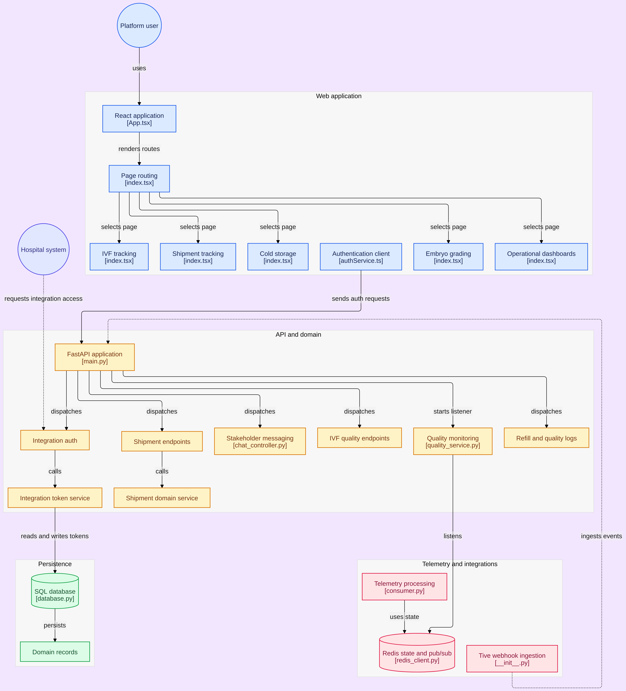

<div align="center">

# ❄️ Vyrona

**Real-Time Cold Chain, Specimen Journey & Cryogenic Telemetry Platform**

A production-grade supply chain intelligence and clinical tracking platform engineered for cryogenic cold chain custody, IVF biological specimens, IoT sensor telemetry, and multi-channel critical alert management.

[](https://fastapi.tiangolo.com)
[](https://react.dev/)
[](https://www.typescriptlang.org/)
[](https://www.postgresql.org/)
[](https://redis.io/)
[](https://www.docker.com/)
[](https://aws.amazon.com/)

</div>

---

## 🏛️ System Architecture

### Visual Architecture Diagram



### High-Level Architecture Flow

```mermaid
flowchart TD

subgraph group_client["Web Application (React 19 + TypeScript)"]
  node_webapp["React Application<br/>[App.tsx]"]
  node_routes["Routing & Navigation<br/>[routes/index.tsx]"]
  node_controltower["Control Tower Map<br/>[ControlTowerMap.tsx]"]
  node_tracking["Shipment Tracking<br/>[Track/index.tsx]"]
  node_ivftracking["IVF Specimen Tracking<br/>[IVFTrackShipment]"]
  node_coldstorage["Cold Storage & Cryocan<br/>[RefrigeratorTracking]"]
  node_embryo["AI Embryo Grading<br/>[EmbryoGrading]"]
  node_dashboard["Executive Dashboard<br/>[Dashboard/index.tsx]"]
  node_authui["Auth & RBAC Client<br/>[authService.ts]"]
end

subgraph group_api["API Gateway & Domain Services (FastAPI)"]
  node_api["FastAPI Core Application<br/>[backend/app/main.py]"]
  node_authcontroller["Authentication & RBAC<br/>[auth.py]"]
  node_shipmentcontroller["Shipment Endpoints<br/>[shipment_controller.py]"]
  node_ivfcontroller["IVF Quality Endpoints<br/>[ivf_quality_controller.py]"]
  node_alertcontroller["Critical Alert Engine<br/>[critical_alert_controller.py]"]
  node_chatcontroller["Stakeholder Messaging<br/>[chat_controller.py]"]
  node_qualityservice["Quality Monitoring Service<br/>[quality_service.py]"]
end

subgraph group_notifications["Alerting & Notification Infrastructure"]
  node_awssns["AWS SNS Service<br/>(SMS Broadcast & Topics)"]
  node_emailservice["Email Service<br/>(HTML Notifications & OTP)"]
end

subgraph group_persistence["Persistence Layer"]
  node_database[("PostgreSQL Database<br/>[SQLAlchemy 2]")]
  node_redis[("Redis 7<br/>[Pub/Sub & Cache]")]
  node_azurite[("Azure Blob / Azurite<br/>[Media & Specimen Storage]")]
end

subgraph group_telemetry["Telemetry Ingestion & Edge Devices"]
  node_tive["Tive IoT Sensors & Trackers"]
  node_webhook["Tive Webhook Receiver<br/>[tive-ingestion-function]"]
  node_telemetryservice["Telemetry Stream Worker<br/>[telemetry-service]"]
  node_simulator["Live Deviation Simulator<br/>[simulate_live_deviation.py]"]
end

%% User interactions
node_user(("Platform User")) -->|"Uses"| node_webapp
node_hms(("Hospital System (HMS)")) -.->|"API Integration"| node_authcontroller

%% Client internals
node_webapp --> node_routes
node_routes --> node_controltower
node_routes --> node_tracking
node_routes --> node_ivftracking
node_routes --> node_coldstorage
node_routes --> node_embryo
node_routes --> node_dashboard
node_authui -->|"Bearer Token"| node_api

%% API routing
node_api --> node_authcontroller
node_api --> node_shipmentcontroller
node_api --> node_ivfcontroller
node_api --> node_alertcontroller
node_api --> node_chatcontroller
node_api --> node_qualityservice

%% Notifications
node_alertcontroller --> node_awssns
node_alertcontroller --> node_emailservice

%% Persistence
node_api --> node_database
node_qualityservice --> node_redis
node_api --> node_azurite

%% Telemetry flow
node_tive -.->|"HTTP Webhooks"| node_webhook
node_webhook --> node_telemetryservice
node_telemetryservice --> node_redis
node_telemetryservice --> node_api
node_simulator -.->|"Simulated Sensor Ingestion"| node_alertcontroller
```



---

## 🌟 Key Features & Capabilities

- **🛰️ Control Tower & Live Geolocation**: Interactive global tracking map using Google Maps JS API with real-time route polyline rendering, dynamic deviation markers, live telemetry overlay, and waypoints.
- **❄️ Cryogenic Cold Storage (LN2) Monitoring**: Precision cryogenic tracking for liquid nitrogen tanks, real-time temperature/evaporation decay modeling, tilt and shock detection, and refill audit logs.
- **🧬 IVF & Biological Specimen Custody**: Full chain-of-custody tracking for embryos, oocytes, and sperm tanks across clinics, labs, and couriers with verification gating.
- **🚨 Multi-Channel Critical Alerting**: Threshold breach detection triggered via real-time telemetry, routing emergency SMS alerts via **AWS SNS**, escalation emails, and push notifications.
- **🧪 Real-Time Deviation Simulator**: Built-in test harness (`simulate_live_deviation.py`) for injecting realistic multi-step sensor breaches (temperature spikes, humidity loss, GPS route deviation) into active shipments.
- **🔬 AI Embryo Grading**: Image-based morphological scoring and stage verification workflows for laboratory embryologists.
- **🔒 Granular RBAC & Security**: Role-based access control (Super Admin, Hospital Admin, Clinician, Courier, Patient) backed by JWT authorization.

---

## 📁 Repository Structure

```text
mG-SCALE/
├── architecture-diagram.png     # Rendered system architecture diagram
├── diagram(2).png              # Architectural graphic asset
├── deploy.sh                   # One-command AWS EC2 deployment automation
├── deploy-nginx.conf           # Production Nginx reverse-proxy configuration
├── docker-compose.aws.yml      # Multi-container stack optimized for AWS EC2
├── docker-compose.yml          # Local multi-service development stack
├── backend/                    # FastAPI REST API Backend
│   ├── app/
│   │   ├── auth/               # JWT authentication & password policies
│   │   ├── config/             # Pydantic environment configuration
│   │   ├── controller/         # REST API routers & route handlers
│   │   │   └── IVF/            # IVF-specific endpoints (quality, alerts, dashboard)
│   │   ├── models/             # SQLAlchemy ORM database models
│   │   ├── service/            # Core business domain logic
│   │   │   ├── aws_sns_service.py # AWS SNS emergency broadcast integration
│   │   │   └── email_service.py   # Transactional email dispatcher
│   │   └── templates/emails/   # Responsive HTML email notification templates
│   ├── migration/              # Alembic database migration revisions
│   ├── scripts/                # Utility & demo simulation tools
│   │   ├── seed_rich_demo_data.py # Populates complete realistic demo data
│   │   └── simulate_live_deviation.py # Injects live sensor threshold breaches
│   ├── seed_db.py              # Base database seeder script
│   └── pyproject.toml          # Poetry dependency manifest
├── FrontEnd/                   # React 19 + TypeScript Frontend
│   ├── src/
│   │   ├── components/         # Reusable UI widgets & ControlTowerMap
│   │   ├── contexts/           # Global providers (Auth, Google Maps, Capability)
│   │   ├── pages/              # Primary route views (Dashboard, Track, Cryocan, etc.)
│   │   ├── routes/             # App routing tree & role-guarded paths
│   │   └── services/           # Axios HTTP API client layers
│   └── vite.config.ts          # Vite build & bundle configuration
├── telemetry-service/          # IoT ingestion function & stream processor
├── tive-ingestion-function/    # Azure Function webhook receiver for Tive trackers
└── DEVELOPER_SETUP_GUIDE.md    # Exhaustive developer workstation setup guide
```

---

## 🛠️ Technology Stack

| Domain | Technology | Description |
| :--- | :--- | :--- |
| **Backend Framework** | **FastAPI** (Python 3.12+) | High-performance async REST API framework |
| **Data Persistence** | **PostgreSQL 16** + **SQLAlchemy 2** | Relational data store with Alembic schema migrations |
| **Caching & Pub/Sub** | **Redis 7** | In-memory message broker, queue, and KPI cache |
| **Frontend Framework** | **React 19** + **TypeScript** | Strict component-driven UI with Vite 7 build tooling |
| **UI Design System** | **Tailwind CSS 4** + **Material-UI 7** | Clean responsive layouts, dark/light aesthetics, bento grids |
| **Mapping & Geospatial**| **Google Maps JavaScript API** | Satellite/roadmap projection, waypoint overlays, path interpolation |
| **Alerting & Cloud** | **AWS SNS** + **SMTP / SES** | Real-time SMS broadcast and transactional notification delivery |
| **Cloud Hosting** | **AWS EC2** (Ubuntu) + **Nginx** | Containerized backend services with Nginx frontend edge |

---

## 🚀 Quick Start Guide

### 1. Prerequisites
- **Docker & Docker Compose** (v2+)
- **Python 3.12+** and **Poetry**
- **Node.js 20+** and **npm**

---

### Option A: Run via Docker Compose (Recommended for Local Dev)

Spin up PostgreSQL, Redis, Azurite, and backend services with a single command:

```bash
# Clone the repository
git clone git@github-akshi-x:Akshi-X/Vyrona_updated.git
cd Vyrona_updated

# Start local infrastructure
docker compose up -d

# Verify services are healthy
docker compose ps
```

---

### Option B: Manual Local Setup

#### Step 1: Backend Setup
```bash
cd backend

# Install dependencies via Poetry
poetry install

# Copy environment configuration
cp .env.example .env

# Run database migrations
poetry run alembic upgrade head

# Seed initial baseline data
poetry run python seed_db.py

# Optional: Seed rich demo scenarios (shipments, incubators, tanks)
poetry run python scripts/seed_rich_demo_data.py

# Start backend server
poetry run uvicorn app.main:app --host 0.0.0.0 --port 8000 --reload
```
API Documentation will be available at: **http://localhost:8000/docs**

#### Step 2: Frontend Setup
```bash
cd FrontEnd

# Install npm packages
npm install

# Copy environment configuration
cp .env.example .env

# Start Vite dev server
npm run dev
```
Web app will be available at: **http://localhost:5173**

---

## 🧪 Real-Time Deviation Simulation

Vyrona includes an automated live simulation engine to demonstrate real-time telemetry processing, trigger deviation badges on the Control Tower map, and test AWS SNS alerts:

```bash
# From the backend directory:
poetry run python scripts/simulate_live_deviation.py
```
This script steps through a shipment journey, simulates GPS waypoints, injects an out-of-spec temperature excursion, and triggers critical alerts through the notification pipeline.

---

## 🚢 Deployment to AWS EC2

Automated deployment tooling is provided in `deploy.sh` to update an AWS EC2 host:

```bash
# Deploy both Backend & Frontend:
./deploy.sh all

# Deploy only Backend updates:
./deploy.sh backend

# Deploy only Frontend build:
./deploy.sh frontend
```

*For complete step-by-step production setup on AWS or Azure, see [DEVELOPER_SETUP_GUIDE.md](./DEVELOPER_SETUP_GUIDE.md) and [AZURE_DEPLOYMENT.md](./AZURE_DEPLOYMENT.md).*

---

## 📚 Supplementary Documentation

- 📖 **[Developer Setup Guide](./DEVELOPER_SETUP_GUIDE.md)**: Exhaustive manual environment setup instructions.
- 📐 **[Technical Documentation](./TECHNICAL_DOCUMENTATION.md)**: Deep dive on domain models, auth flows, and schema tables.
- ☁️ **[Azure Deployment Guide](./AZURE_DEPLOYMENT.md)**: Cloud deployment instructions for Azure App Service & EventHub.
- 🔐 **[OTP Configuration Guide](./OTP_CONFIGURATION.md)**: One-time password verification modes & email templates.
- 🗺️ **[Route Index](./ROUTES.md)**: Comprehensive mapping of frontend URLs and backend endpoints.

---

## 👥 Authors

- **Akshith Mahesh K** ([@Akshi-X](https://github.com/Akshi-X))

---

## 📄 License

This project is proprietary and confidential. All rights reserved.
